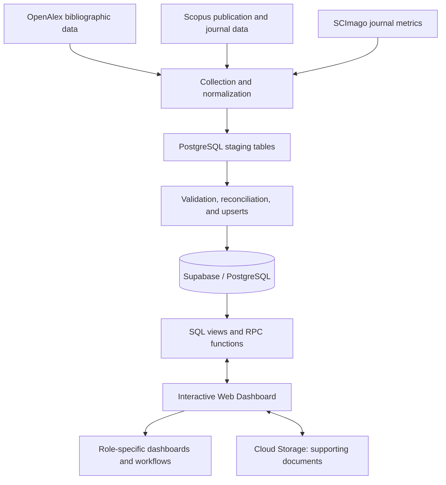

# Islamic University - Customized Research Information System

### Comprehensive Research Information System

A research management and analytics platform developed as a Computer Science B.Sc. graduation project for the **Islamic University of Madinah**, with workflows for the Deanship of Scientific Research, academic leaders, researchers, and students.

CRIS brings publication records, researcher identities, journal metrics, research incentives, and institutional reporting into one application. Its central engineering challenge is turning overlapping scholarly datasets into traceable records that support both research analysis and administrative decisions.

**Author:** Abdulrahman Alkhatib  
**Contribution:** Full-stack application development, database engineering, scholarly data integration, and analytics.

Scroll to -> [Capabilities](#capabilities) · [Architecture](#architecture) · [Author](#author)

## The problem

Research information is distributed across bibliographic providers and institutional workflows. The same paper can have different identifiers, citation counts, author affiliations, and journal classifications in different sources. Academic leaders also need different views of this information depending on their college, department, or university responsibilities.

This project extends an OpenAlex-based research catalog with Scopus ingestion, source reconciliation, journal intelligence, and role-specific workflows via API to automate the process of collecting data. It retains source distinctions so users can investigate coverage and citation differences rather than treating every provider as interchangeable.

### Implemented Components (as required by the deanship of post-graduate & scientific research)

| Area                            | Implemented functionality                                                                                                                              |
| ------------------------------- | ------------------------------------------------------------------------------------------------------------------------------------------------------ |
| Publication catalog             | Search and filter publications, inspect source badges and citation metrics, and submit DOI-based requests for review.                                  |
| Researcher records              | Researcher profiles, scholarly identifiers, affiliation data, and administrative duplicate review and merging.                                         |
| Research analytics              | University, college, and department dashboards; publication trends by source; citation comparisons; quartile distributions; and publication forecasts. |
| Journal discovery               | Journal search and matching, subject filters, university publication history, SJR/CiteScore views, and category/year-specific Scopus rankings.         |
| Research incentives             | Excellence and post-publication applications, policy-based calculations, supporting PDFs, staged review, and audit history.                            |
| Theses                          | Student submissions, administrative review, a thesis catalog, and scoped analytics.                                                                    |
| Innovation and entrepreneurship | Records for innovation projects, programs, events, prototypes, and startups.                                                                           |
| Administration                  | User and role management, institutional structure, integration settings, notifications, and audit logs.                                                |
| Bilingual interface             | Arabic and English with right-to-left and left-to-right layouts.                                                                                       |

The application defines access for administrators, the Dean of Scientific Research, college deans, department heads, auditors, faculty, students, and entrepreneurship staff. Database policies and RPC checks complement the interface's route permissions.

## Reported data scale

The following figures describe a **reported project dataset snapshot**, drawn from the project summary and supplied showcase figures. Current values can change after ingestion, exclusions, or identity reconciliation.

| Metric                                                     | Reported value |
| ---------------------------------------------------------- | -------------: |
| Unique publications                                        |          7,352 |
| Publications linked across Scopus and OpenAlex             |          5,223 |
| Citation total                                             |         71,567 |
| Researcher/author records enriched with Scopus identifiers |          2,426 |
| Unique journal keys in the Scopus staging dataset          |          1,477 |
| Author affiliation records                                 |         32,207 |

Publication, author, affiliation, and journal counts represent different entities. Citation totals depend on the selected source and counting method; Scopus and OpenAlex counts should not simply be added together.

## Architecture

This diagram summarizes the main data and application layers. Individual source imports have different collection paths and prerequisites; a scheduled, unattended deployment is not implied.

## Technology stack

| Layer                    | Technologies                                                                               |
| ------------------------ | ------------------------------------------------------------------------------------------ |
| Application              | React 19, TypeScript, TanStack Start, TanStack Router                                      |
| Build and server tooling | Vite 7, Nitro                                                                              |
| UI                       | Tailwind CSS 4, Radix UI, shadcn/ui-style components, Lucide icons                         |
| Data fetching            | TanStack Query 5, Supabase JavaScript client                                               |
| Backend                  | Supabase Auth, PostgreSQL, PL/pgSQL functions, views, row-level security, Supabase Storage |
| Analytics                | Recharts, SQL aggregations, forecast calculations                                          |
| Data engineering         | Python collection and validation scripts, SQL staging and reconciliation                   |
| Scholarly data           | OpenAlex, Elsevier Scopus, SCImago SJR; Crossref metadata lookup for publication requests  |

## Institutional context and publication scope
> [!IMPORTANT]
> Institutional Project Notice:  
> This repository presents an academic engineering case study developed in an institutional context. Production credentials, private account data, and restricted scholarly exports are outside the intended public showcase scope. Reuse of code, institutional material, and provider data depends on the applicable permissions and license terms. This README does not grant an open-source license.

## Author

**Abdulrahman Alkhatib**  
- GitHub: [@AbdulrahmanAKh](https://github.com/AbdulrahmanAKh)  
- LinkedIn: [https://www.linkedin.com/in/abdulrahman-alkhatib/](https://www.linkedin.com/in/abdulrahman-alkhatib/)
- Email: [aboodkhatib90@gmail.com](mailto:aboodkhatib90@gmail.com)  
- Portfolio: [https://abdulrahmanakh.github.io/](https://abdulrahmanakh.github.io/)

---

  <b>Developed & Engineered by Abdulrahman Alkhatib</b> 
  <i>Computer Science Graduate | Software & AI Engineer</i>

